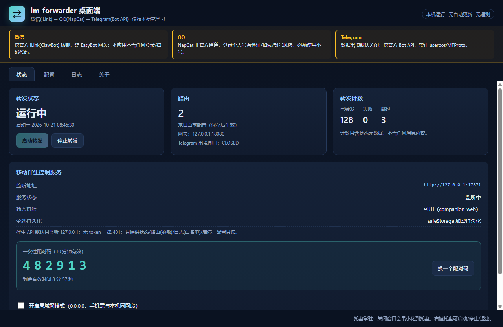
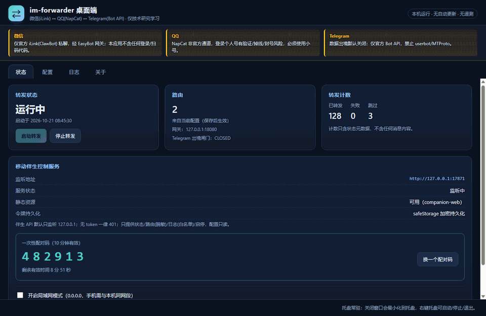

# im-forwarder · WeChat ↔ QQ ↔ Telegram メッセージ転送ルーター

[简体中文](README.md) | [English](README.en.md) | [日本語](README.ja.md) | [繁體中文](README.zh-TW.md)

[](https://github.com/DaiYiqq/im-forwarder/actions/workflows/ci.yml)
[](LICENSE)


> 🧪 **オンラインデモ（静的・バックエンドなし）**：https://daiyiqq.github.io/im-forwarder/
> コンプライアンスゲートの判定チェーン・越境ゲート・ルーティングマトリクスを体験できます。プラットフォーム接続・メッセージ送信・データ収集は一切ありません。実際の転送にはデスクトップ版と自前の EasyBot ゲートウェイが必要です。

> ## ⚠️ 非商用限定 — 有料サービス・有料ホスティング禁止
>
> 本プロジェクトは**技術研究および個人学習のみ**を目的としています。
> WeChat 側は Tencent 公式の **iLink（ClawBot）** オープン機能に接続し、そのライセンスは
> **非商用**に限定されています。[LICENSE](LICENSE) は MIT + Commons Clause を採用し、
> **販売・有料ホスティング・転売**を明示的に禁止します。
> 有料の転送サービス、有料ホスティング、商用製品への組み込みは**許諾されていません**。
>
> 商用のクロスプラットフォーム同期が必要な場合は、各プラットフォームの公式エンタープライズ
> ソリューションを申請してください。本プロジェクトをその目的で使用しないでください。

---

## 1. リスク警告（インストール前に必ず全文を読んでください）

1. **技術研究・学習のみ。商用利用禁止。** [LICENSE](LICENSE) を参照
   （MIT + Commons Clause：課金・有料ホスティング・転売の禁止）。
2. **WeChat 側は公式 iLink（ClawBot）チャネルのみ**を使用します（エンドポイント
   `ilinkai.weixin.qq.com`、認可は EasyBot ゲートウェイ側で完了）。
   本リポジトリには WeChat のログイン・QR コード・Cookie・Web プロトコル・iPad プロトコル・
   Hook・リバースエンジニアリングのコードは**一切含まれません**。
   WeChat 側は**個人チャットのみ**を扱います。グループメッセージの送受信は行わず、
   友だちリスト・メッセージ取り消し・履歴照会も使用しません。
   iLink は**非商用**ライセンスであるため、有料での利用は当該ライセンスにも違反します。
3. **QQ 側は NapCat + OneBot 11 を使用します。これは QQ 公式のボットチャネルではありません。**
   NapCat で個人 QQ アカウントにログインすると、**ログイン確認・頻繁な切断・アカウント停止**
   のリスクがあります。**必ず専用のサブアカウントを使用し、メインアカウントは絶対に使わないでください。**
   すべての結果は利用者の責任です。
4. **Telegram 側は公式 Bot API のみ**を使用します（BotFather で作成したボット）。
   MTProto userbot、Telethon、Pyrogram など、**個人アカウントとしてログインする方式は厳禁**であり、
   本コードベースには存在しません。ボットは、ユーザーが自発的に送ったメッセージ、または
   参加グループ内で許可されたメッセージのみ受信できます。本プロジェクトは個人チャット履歴や
   他人の会話を読もうとしません。
5. **データの越境移転（重要）**：Telegram のサーバーは**中国境外**にあります。
   WeChat/QQ から Telegram へメッセージを転送することは、**中国の個人情報保護法（PIPL）第 38 条に
   いう「個人情報の国外提供」に該当する可能性があります**。したがって：
   - Telegram への転送は**デフォルトで無効**であり、設定で明示的に有効化する必要があります；
   - 有効化時には「**本人のメッセージのみを転送し、他人のチャット内容は転送しない**」ことの
     確認が必須です；
   - 第 38 条・第 39 条との対応は [COMPLIANCE.md](docs/en/COMPLIANCE.en.md) を参照してください。
6. **ネットワークアクセスの適法性**：中国本土からの Telegram へのアクセスは関連法令の制約を
   受けます。利用者は自身のネットワークアクセスが適法であることを自ら確保してください。
   **本プロジェクトは回避手段を提供せず、推奨もしません**。プロキシ・トンネル・難読化などの
   コードや設定はリポジトリに存在しません。
7. **免責**：アカウント停止、データ漏洩、第三者による滥用、所在国の法令違反などについて、
   作者は一切の責任を負いません。本プロジェクトは [LICENSE](LICENSE) に基づき「現状のまま」
   提供され、明示・黙示を問わずいかなる保証も伴いません。

> 本プロジェクトは法的助言ではありません。個人情報の取扱いに関する判断は、必ず専門の弁護士に
> ご相談ください。

---

## 2. できること / できないこと

| | 本プロジェクト | 説明 |
|---|---|---|
| プロトコル層 | ❌ 行わない | WeChat iLink / NapCat / Telegram Bot API の接続はすべて **EasyBot ゲートウェイ**が担当 |
| 転送ルーティング | ✅ 行う | `送信元プラットフォーム:会話 → 送信先プラットフォーム:会話` のマトリクス。任意の 2 プラットフォーム間に対応 |
| メッセージ種別 | テキストのみ | それ以外は**明示的に応答してスキップ**。黙って破棄せず、メディアを解析・ダウンロードしない |
| WeChat グループ | ❌ 行わない | コンパイル時と実行時の二重に拒否。**設定で有効化するスイッチは存在しない** |
| メッセージ永続化 | ❌ 行わない | DB・ディスクキュー・キャッシュなし。本文はメモリ内のみ |
| 本文のログ出力 | ❌ 行わない | ログ項目はホワイトリスト方式で、本文を入れられる項目が存在しない |
| 他人の内容の転送 | デフォルト無効 | 「通知—同意」フローが必要。同意前は転送しない |
| Telegram 越境 | デフォルト無効 | 4 つの確認がすべて必要。1 つでも欠けると**起動を拒否** |

### データフロー

```
                    ┌──────────────────────────────────────────┐
  WeChat 個人チャット ▶│  EasyBot 統合 IM ゲートウェイ            │
  QQ 個人チャット     ▶│  · 各プラットフォームの PlatformAdapter  │
  Telegram Bot       ▶│  · 統一 REST（送信）+ WebSocket（受信）  │
                    └───────────────────┬──────────────────────┘
                                        │  正規化イベント / 送信リクエスト
                                        ▼
                    ┌──────────────────────────────────────────┐
                    │  im-forwarder（本リポジトリ）            │
                    │  事前コンプライアンス検査 → ルート行列    │
                    │  → ポリシーチェーン → テキスト変換       │
                    │  → 送信 → ホワイトリストログ             │
                    └──────────────────────────────────────────┘
```

本サービスは**プラットフォームの認証情報を保持しません**。保持するのは EasyBot ゲートウェイの
トークン 1 つだけで、環境変数から読み込みます。

---

> デスクトップ（Windows/macOS/Linux）とモバイル（PWA / Android APK）のインストール手順は [docs/en/INSTALL.en.md](docs/en/INSTALL.en.md)（英語）を参照。iOS 用のパッケージは提供していません。

## UI プレビュー（実際のデスクトップ版 · デモデータ）





**実際の Electron レンダラー**をオフスクリーンで撮影したものです（`apps/desktop/scripts/capture-main.cjs`）。
固定のデモデータのみで、**実際のチャット内容やトークンは含みません**。オンラインデモでは
中国語/英語の切り替え、越境ゲート、ルーティングマトリクスの編集、スクリーンショットを確認できます：
https://daiyiqq.github.io/im-forwarder/

## 3. クイックスタート

### 前提条件

- Node.js ≥ 20（開発・検証は Node 24）
- 稼働中の **EasyBot ゲートウェイ**で、以下が設定済みであること：
  - WeChat：公式 iLink（ClawBot）チャネルの認可（QR 認可はゲートウェイ側で実施）
  - QQ：NapCat ログイン（**専用サブアカウントを使用**）
  - Telegram（任意）：BotFather のボットをゲートウェイに接続
- 本リポジトリは上記を一切行わず、代行もしません。

### インストール

```powershell
git clone https://github.com/DaiYiqq/im-forwarder.git
cd im-forwarder
npm install
Copy-Item config/config.example.yaml config/config.yaml
# 注意：本プロジェクトは .env を読み込みません（dotenv 依存なし）。
# トークンは実際の環境変数で渡してください。
```

### トークンの設定（環境変数のみ）

```powershell
$env:EASYBOT_TOKEN = "<EasyBot ゲートウェイのトークン>"
```

### 起動前セルフチェック（毎回推奨）

```powershell
npx tsx src/main.ts --config config/config.yaml --self-check
# 終了コード 0 = 設定とコンプライアンス検査に合格 / 78 = 拒否（理由と修正方法を表示）
```

### 実行

```powershell
npm start
```

### 実アカウント不要のローカル結合テスト（モックゲートウェイ）

```powershell
npm run mock    # ターミナル A：偽ゲートウェイ（実プラットフォームには一切接続しない）
# ターミナル B：baseUrl/eventsUrl を表示されたアドレスに向けて npm start
```

---

## 4. ルーティングマトリクス

ルーティングは**有向エッジの表**であり、2 者間のハードコードではありません：

```yaml
routes:
  - id: wx-private-to-qq          # WeChat 個人 → QQ 会話
    group: self-wx-qq             # 論理チェーン。ループ防止は group 単位
    contentOwner: self            # 必須：self | third-party（デフォルトなし）
    from: { platform: wechat, conversationId: "wxid_xxx", chatType: private }
    to:
      - { platform: qq, conversationId: "10001", chatType: private }

  - id: qq-to-wx-private          # 逆方向エッジ（同じ group）
    group: self-wx-qq
    contentOwner: self
    from: { platform: qq, conversationId: "10001", chatType: private }
    to: { platform: wechat, conversationId: "wxid_xxx", chatType: private }
```

コンパイル時の規則（違反すると**起動拒否**、自動解決はしない）：
`chatType` は `private` のみ（全プラットフォーム。グループは一切非対応）、
`from`/`to` の同一は不可、同一 `group` の `contentOwner` は一致必須、
重複 id・重複エッジは失敗、ループがある場合は `loopGuard` 有効が必須で、ループは group を跨げません。

ループ防止は 3 層：**エコー `messageId` → 短期 HMAC フィンガープリント（メモリのみ）→
ホップ予算**（デフォルト `maxHops: 1`）。詳細は [docs/en/ROUTING.en.md](docs/en/ROUTING.en.md)（中国語）。

---

## 5. コンプライアンススイッチ（デフォルト全無効、欠落＝起動拒否）

### データ越境（PIPL 第 38/39 条）

```yaml
compliance:
  telegramCrossBorder:
    enabled: true
    operator: "あなたの名前"                      # 誰が有効化したか（追跡可能に）
    acknowledgedAt: "2026-10-18T12:00:00+08:00"  # ISO 8601
    selfMessagesOnlyConfirmed: true              # 本人のメッセージのみ
    riskNoticeVersion: "2026-10-18.v1"           # 通知文の版が変わると再確認が必要
```

1 つでも欠ける／版が一致しない → `CROSS_BORDER_GATE_CLOSED` /
`CROSS_BORDER_ACK_INCOMPLETE` → **exit 78**。

### 他人のチャット内容（PIPL 第 23 条）

デフォルトでは third-party ルートは**存在しません**。他人の内容を転送するには同意メカニズムを
有効化し、各送信先に通知要素（`receiver.*`）を設定する必要があります。最初のメッセージは
**転送されず**、通知が送られ、相手が同意キーワードを返信して初めて転送が始まります。
越境チェーンでは**独立した 2 回の同意**が必要です。
詳細：[docs/en/CONSENT-FLOW.en.md](docs/en/CONSENT-FLOW.en.md)（中国語）、[COMPLIANCE.md](docs/en/COMPLIANCE.en.md)。

---

## 6. ログとプライバシー

```json
{"ts":"2026-10-18T12:34:56.789Z","level":"info","event":"forward","status":"forwarded","routeId":"wx-private-to-qq","sourcePlatform":"wechat","targetPlatform":"qq","latencyMs":42}
```

- ホワイトリスト項目のみ（`ts/level/event/routeId/sourcePlatform/targetPlatform/status/errorCode/...`）；
- **本文・会話 ID・ニックネームは出力しません**；
- 長すぎる文字列は `[omitted:N]` に置換され、正当な項目への本文混入を防ぎます；
- この性質は `test/redaction.spec.ts` が canary 文字列で検証しています（口約束ではありません）。

---

## 7. 既知の制限（誇張なし）

1. **ゲートウェイ契約の確認が必要**：差異は `gateway.fieldMap` と `gateway.send.path` で吸収します。
   プラットフォーム SDK の追加は**禁止**。
   詳細：[docs/en/GATEWAY-CONTRACT.en.md](docs/en/GATEWAY-CONTRACT.en.md)（中国語）。
2. **テキストのみ**：メディアは明示的にスキップ。ダウンロード・デコードは行いません。
3. **グループチャット非対応**（全プラットフォーム。グループではメンバーごとの同意が取れないため）。
4. **同意メカニズムの限界**：その個人チャットの返信者が同意したことしか証明できず、
   本人性は検証できません。転送済みの内容は取り消せません。
5. **メモリ消去は保証できません**：JS ランタイムに制御可能なゼロ化はありません。
   保証できるのは「ディスクに書かない・ログに出さない・キューに積まない」ことだけです。
6. **NapCat の切断・アカウント停止は避けられません**。非公式チャネルの本質的リスクです。
7. **`contentOwner` は自己申告**：他人の会話を `self` と書けば同意フローを回避できます。
   プログラムは会話の帰属を判定できません。
8. **同意記録に署名はありません**：`data/consent.json` はローカル JSON で偽造可能、
   内部的な信頼性のみです。
9. **信頼境界はゲートウェイ**：`chatType`、`senderIsSelf`、`senderIsBot` はゲートウェイの報告値です。
   誤報告があれば対応するハードゲートは機能しません。ゲートウェイ側のコンプライアンスは
   本リポジトリの管理外であり、最大の未知要素です。

---

## 8. 品質ゲート

```powershell
npm run check        # 型検査 + 静的コンプライアンススキャン + 全テスト（63 件）
npm run typecheck
npm run compliance:scan
npm test
```

CI：[.github/workflows/ci.yml](.github/workflows/ci.yml)。
独立監査レポート：[docs/en/AUDIT.en.md](docs/en/AUDIT.en.md)（8 項目の受入基準、ブラックボックスの終了コード、
PoC、是正記録。本文は中国語）。

---

## 9. 開発者連絡先

| チャネル | 情報 |
|---|---|
| 開発者 | **戴亿（DaiYi）** |
| GitHub | [@DaiYiqq](https://github.com/DaiYiqq) |
| メール（QQ） | **1703205607@qq.com** |
| メール（Gmail） | **daiy91004@gmail.com** |
| QQ | **1703205607** |
| WeChat | **daiyi091004** |
| 抖音（Douyin） | **daiyi091004** |
| Issue（バグ報告に推奨） | [github.com/DaiYiqq/im-forwarder/issues](https://github.com/DaiYiqq/im-forwarder/issues) |

- **セキュリティ脆弱性・滥用報告**は [SECURITY.md](SECURITY.md) を先にお読みください。
  公開 Issue に認証情報・チャット内容・個人情報を書き込まないでください。
- どの連絡チャネルでも機微な個人情報を送らないでください。
- 連絡ポリシーの全文：[CONTACT.md](CONTACT.md)。

---

## 10. コミュニティによる共同メンテナンス

本プロジェクトは**コミュニティによる共同メンテナンス**を前提としますが、譲れない一線があります：
**コンプライアンス不変条件を弱めてはならない**。

- **コントリビューション**：[CONTRIBUTING.md](CONTRIBUTING.md)（中国語・英語）— 手順、コード規約、
  必須チェック、PR が壊してはならない不変条件の一覧。
- **ガバナンス**：[GOVERNANCE.md](GOVERNANCE.md) — 役割、レビュー規則、リリース手順。
- **翻訳**：[TRANSLATIONS.md](TRANSLATIONS.md) — 英語が正本、他言語はコミュニティによるベストエフォート。
- **行動規範**：[CODE_OF_CONDUCT.md](CODE_OF_CONDUCT.md)。
- **コンプライアンス議論**：*compliance concern* の Issue テンプレートを使用。
- **初心者向け**：`good first issue` ラベル。ドキュメント・翻訳の修正は常に歓迎します。

`src/compliance/**`、`src/config/schema.ts`、`LICENSE`、`COMPLIANCE.md` を変更する PR は
2 人目のレビューが必須で、`npm run check` が緑である必要があります（[GOVERNANCE.md](GOVERNANCE.md)）。

---

## 11. ライセンス

MIT **+ Commons Clause**：使用・複製・変更・マージ・公開・配布・再許諾は可能ですが、
**販売・有料ホスティング・転売は禁止**です。全文は [LICENSE](LICENSE) を参照。
この組み合わせは **OSI 承認のオープンソースライセンスではありません**。

Tencent、QQ、Telegram とは無関係です。各商標はそれぞれの権利者に帰属します。
